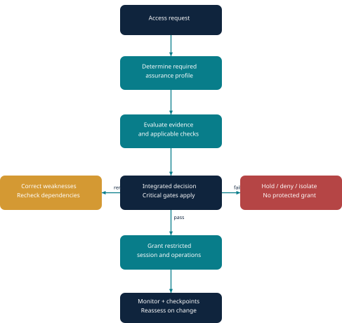
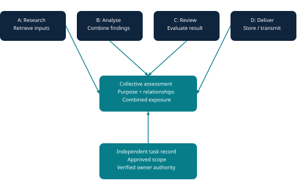
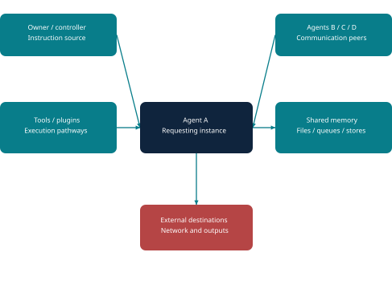
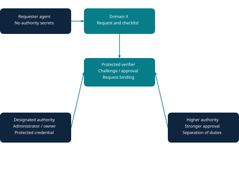
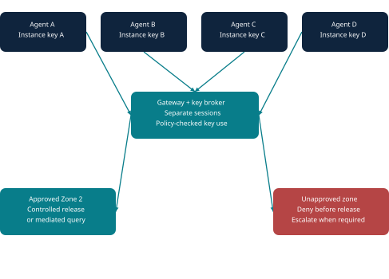
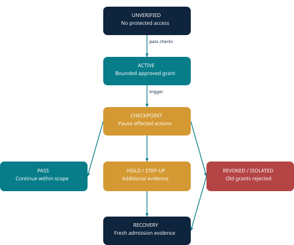

# Architecture specification

**AA-ZTCE — Autonomous Agent Zero-Trust Cryptographic Enclave**  
Proposal originator: Abid Yousef. Clarified visual design: 2.0. Local implementation candidate: 0.2.0.

## Governing principle

Access depends on maintaining the security assurance required for the specific resource, action, agent/group context and current conditions. The design is not a single identity test and does not require blindly repeating every component for every operation.

Before a protected grant, Domain X evaluates the applicable mandatory evidence, establishes required containment, rechecks corrected conditions and determines whether access is permitted and its scope. During execution, current-state checks and injected checkpoints govern continuation. Unknown critical evidence blocks the corresponding access.

## Fourteen control components

| ID | Component | Proposed responsibility |
|---|---|---|
| 01 | Individual identity and authority | Verify execution instance, accountable owner, delegation and clearance separately for every agent. |
| 02 | Collective workflow assessment | Evaluate roles, combined requests, handoffs and their independently authorized objective. |
| 03 | Connection and attack-surface inspection | Examine entry/exit paths, peers, controllers, tools, shared memory and storage. |
| 04 | Controlled sandbox boundaries | Establish and verify the required isolation and mediated communication before access. |
| 05 | Impersonation resistance and hierarchical authority | Strong requester proof plus protected, request-bound approval from the appropriate authority. |
| 06 | Progressive guards A–B–C | Apply stronger verification, restriction or containment when policy conditions require. |
| 07 | Integrated checklist and decision | Resolve all applicable mandatory checks and select grant, restriction, hold, denial or isolation. |
| 08 | Per-agent session cryptography | Separate cryptographic session bindings; restricted key use and short validity. |
| 09 | Zone/clearance enforcement | Enforce resource/action/compartment boundaries and policy-defined responses. |
| 10 | Injected verification | Reassess identity, environment, task and intended next operation during active sessions. |
| 11 | Discontinuity and fresh authentication | Terminate old access after the defined continuity failure and require fresh admission. |
| 12 | Domain monitoring and response | Collect evidence and coordinate deterministic enforcement, alerts and recovery. |
| 13 | Conditional defensive confusion | Proposed higher-layer deception/disruption, separate from normal session encryption. |
| 14 | Computational distortion | Proposed constrained or altered execution semantics for exceptional defensive use. |

These IDs identify functions, not fourteen information zones or a compulsory serial execution order. Components 13–14 are experimental and must not substitute for a hard resource boundary.

## Admission and continuation

A workable grouping is:

1. **Admission assessment:** identity, individual/group workflow, connections, containment and required authority.
2. **Decision:** mandatory-gate evaluation and A–B–C escalation.
3. **Enforcement:** per-instance proof, scoped grants, cryptographic access and zone/compartment restrictions.
4. **Supervision:** current-evidence checks, sensitive-action checkpoints and monitored changes.
5. **Recovery:** fresh evidence and new grants following suspension or revocation.
6. **Experimental defenses:** separately evaluated mechanisms activated only when defined policy calls for them.

Evidence needs a verification source, scope, freshness deadline, dependencies and invalidating events. Reuse is valid only while those properties still apply. A new participant, changed tool, changed output destination or changed task can invalidate dependent checks before it is allowed.

## Individual and collective assessment

Agent A's identity success cannot authenticate B, C or D. Separately valid requests can combine into an unauthorized result, so the group workflow must also be considered. Legitimate roles may differ while serving the same task. Matching explanations alone are not evidence of genuine common authority.

The local core enforces a configured task/member/scope registry. It does not infer hidden intent or discover covert relationships. Those are explicit limits of the implementation evidence.

## Surrounding exposure

Domain X must consider who can influence A, where A can send results, what it shares and what tools can act on its behalf. Inspection must be paired with enforced boundaries; a one-time connection inventory cannot prevent later paths from appearing.

An uncontrolled external environment cannot simply be declared contained. A deployment needs acceptable trusted evidence or must move sensitive processing inside a controlled boundary. No such general-purpose runtime is included in this repository.

## Protected hierarchical authority

Higher-sensitivity access calls for the appropriate responsible authority, potentially stronger evidence and independent approvals. The requester never receives higher-authority secret knowledge or reusable credentials. Approval is bound to agent instance, task, resource, action, session and expiry.

Encryption protects the secret; policy defines who may approve; verifiable request binding establishes what was approved. Approval satisfies one gate and cannot bypass other mandatory checks. The local implementation has one independent signing authority; a full organizational hierarchy is pending.

## Encryption and release

Identity keys, channel/session keys and data-encryption keys have distinct purposes. The WhatsApp analogy expresses protected endpoint communication, not a claim to implement its protocol. Inspection requires a component to be an authorized plaintext endpoint; an unrelated middlebox cannot inspect end-to-end encrypted content.

Keys do not independently detect sensitivity boundaries. A gateway/key broker must enforce policy. Revocation can block future operations but cannot retract released plaintext or a previously delivered usable key.

## Seven illustrative information zones

| Zone | Proposed scenario label |
|---|---|
| 1 | Public information |
| 2 | Private information |
| 3 | Government information |
| 4 | National defence |
| 5 | Security institutions |
| 6 | Higher defence sensitivity |
| 7 | Future security/threats |

These are scenario labels, not an official classification hierarchy. Compartments may be incomparable; a high number must not automatically grant all lower categories. Action consequence and required assurance are separate from zone numbering.

## Checkpoints and response

A checkpoint can pause protected operations, require fresh evidence or revoke access. A disconnect under the strict profile invalidates the session; arbitrary router-hop loss must not be equated with observable identity loss. Successful recovery issues a new grant.

The tightened core pins the instance/key generation and approved task snapshot. It serializes supported lifecycle updates with release. That addresses reproduced local gaps, but it does not prove distributed atomicity or determine whether an unchanged authorized agent has an unexpressed harmful goal.

## Experimental higher-layer mechanisms

Confusion/manipulation and computational distortion remain proposals whose exact activation, containment and effectiveness need evaluation. Candidate decoy routing or restricted interpreters can be investigated separately from real-resource access. Altered instruction semantics do not change ordinary mathematics or guarantee that an AI model becomes confused.

The [visual PDF](AA-ZTCE_Advanced_Visual_Architecture_v2.pdf) contains fuller worked scenarios and control matrices. The [tightened report](TIGHTENED_REPORT.md) is authoritative for the current runtime's fixes and tested scope.
